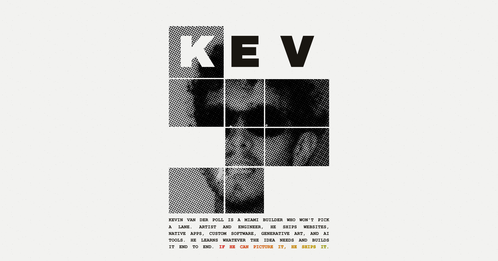

# kevdotnet

The personal site of Kevin van der Poll. Nomadic artist and builder of useful systems and AI tools.

**[kevdotnet.net](https://kevdotnet.net)**

## What's on it

- **The poster.** A halftone wanted poster that types itself in. Press and hold it.
- **[Projects](https://kevdotnet.net/projects).** Things I've built, most with a live preview.
- **[Now](https://kevdotnet.net/now).** What I'm working on at the moment.
- **A working terminal.** Press the backtick key (`` ` ``) on any page.
- **Hidden pages.** A few aren't in the menu. The terminal knows where they are.

## Built with

Next.js, React and TypeScript, hosted on Vercel. No UI libraries: the halftones, physics and animations are hand-written canvas and CSS.

## Using this code

The code is public so people can see how it's made. The photos, writing and design are mine and aren't licensed for reuse.

## Contact

[LinkedIn](https://www.linkedin.com/in/kevinvanderpoll/) · [X](https://x.com/kevdottxt) · [Instagram](https://www.instagram.com/kevdotpng/) · [kevdotnet.net/contact](https://kevdotnet.net/contact)
